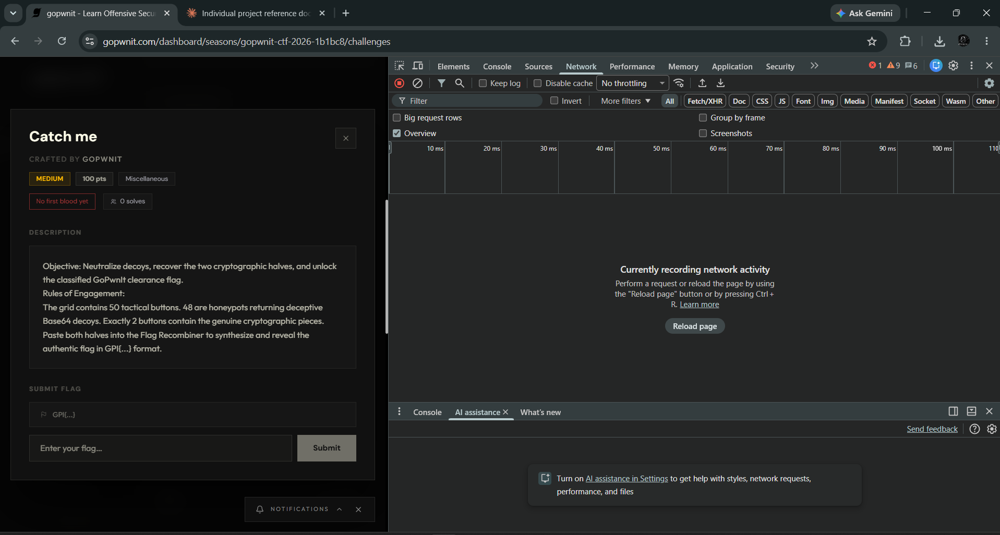

# Catch me
**Category:** Miscellaneous | **Difficulty:** Medium | **Points:** 50 | **Solves:** 51

## What the challenge was
A page with 50 buttons. 48 buttons show fake Base64 flags. 2 buttons hold the real Base64 pieces. I had to merge both pieces to get the flag.

## How I solved it
1. My first paste of the page was only the "Access Denied" login screen. I logged in again and opened the challenge page with the 50 buttons.
2. I opened DevTools (F12) and the Console tab. The page has a popup that shows each button's text, so I used a script to click all 50 buttons and read the popup. The script is `solve.js`.
3. I pasted `solve.js` in the console. It printed a table with all 50 values and what `atob()` gave for each one. A short excerpt is in `evidence/console-output-excerpt.txt`.
4. 48 values ended with `==` and decoded to random bytes. Button 17 and button 37 didn't end with `==`. They were shorter, with 22 characters each.
5. Button 17 decoded to `GPI{TH0NKYOU_D1R`. That looked like the start of a flag. Button 37 alone decoded to junk, which first looked like a decoy. But the page said to merge the 2 parts, and Base64 only works when the whole string is joined.
6. So I joined button 17 + button 37 into one string and decoded it with `python3 -I solve.py`. Output is in `evidence/decode-output.txt`.
7. The joined string decoded to the flag below.
8. I didn't paste the parts into the page's merge box myself in this session. I only decoded them with Python, so the python output is my proof.

## Flag
`GPI{TH0NKYOU_D1RLING_T0_F8IND_M1}`

## Tools used
- Chrome DevTools console
- Python 3 (base64 module)
